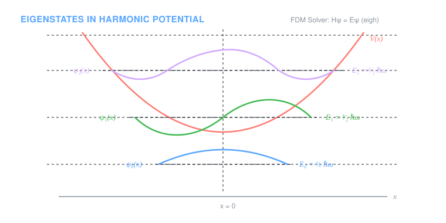
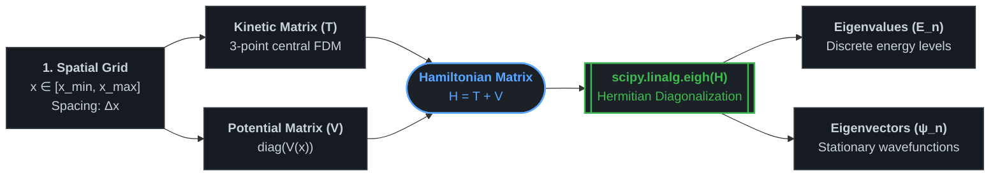

# Quantum Mechanics: 1D Bound State Solvers

A collection of numerical and analytical solutions to the 1D time-independent Schrödinger equation for canonical quantum potentials:

$$\hat{H}\psi = \left( -\frac{\hbar^2}{2m}\frac{d^2}{dx^2} + V(x) \right)\psi = E\psi$$

<p align="center">
  
</p>

---

## Physics & Numerical Methods
* **Spatial Discretization:** The continuous coordinate $x$ is mapped to a discrete grid of $N$ points with spacing $\Delta x$.
* **Finite Difference Kinetic Operator:** The second spatial derivative is approximated via a 3-point central difference scheme:
  $$\frac{d^2\psi}{dx^2} \approx \frac{\psi_{i+1} - 2\psi_i + \psi_{i-1}}{\Delta x^2}$$
* **Matrix Diagonalization:** The Hamiltonian matrix $\hat{H} = \hat{T} + \hat{V}$ is diagonalized using `scipy.linalg.eigh` to extract eigenvalues (energies $E_n$) and eigenvectors (stationary states $\psi_n(x)$).
* **Scattering & Tunneling:** Analytical calculation of transmission coefficients $T$ for unbound states ($E < V_0$) to study quantum tunneling exponentially decaying wavefunctions.



---

## 📂 Included Scripts

| Script | Potential $V(x)$ | Method | Highlights |
| :--- | :--- | :--- | :--- |
| **`particle_in_a_box_analytical.py`** | Infinite Well  ($0 \le x \le L$) | Analytical | Exact closed-form solutions, energy scaling $\propto n^2$, and probability density $|\psi(x)|^2$ filling. |
| **`particle_in_a_box_numerical.py`** | Infinite Well  ($0 \le x \le L$) | Finite Differences | Discrete tridiagonal Hamiltonian benchmarking numerical roots against analytical spectra. |
| **`quantum_dots_finite_well.py`** | Finite Well  ($V_0 = 20\text{ eV}$) | Finite Differences | Models electron confinement in semiconductor quantum dots; filters bound states ($E < V_0$) and plots energy-offset wavefunctions. |
| **`quantum_harmonic_oscillator.py`** | Parabolic  ($\frac{1}{2}m\omega^2 x^2$) | Finite Differences | Equispaced energy ladder $E_n = \hbar\omega(n + 1/2)$, parity analysis of odd/even eigenstates. |
| **`quantum_tunneling.py`** | Finite Barrier  ($V_0 > E$) | Analytical | Computes transmission probability $T$, demonstrates log-scale exponential decay over barrier width $L$, and generates 2D $(L, V_0)$ colormaps with contour levels. |

---

### Prerequisites

Ensure you have Python 3.8+ installed along with the required scientific packages:

```bash
git clone https://github.com/Pau-Gallego-Cistero/quantum-computing-projects.git
cd quantum-computing-projects
pip install numpy scipy matplotlib
